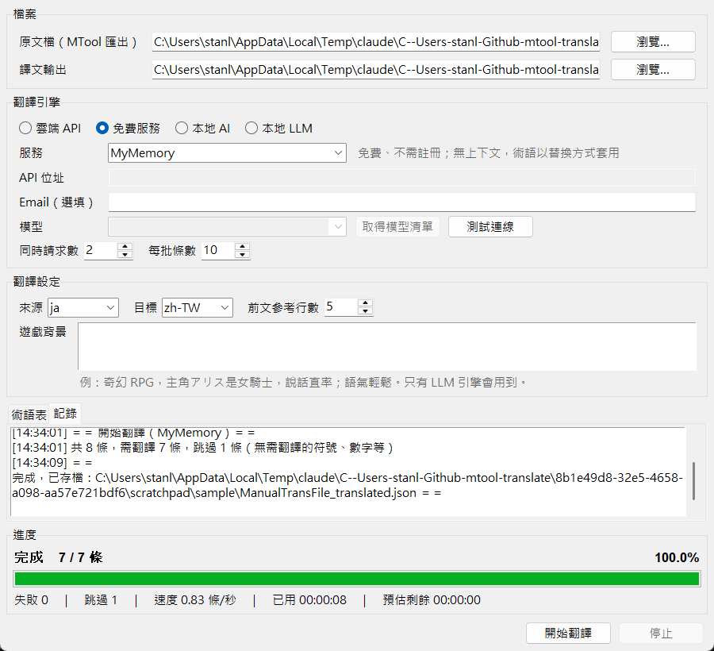

# [MT-2] 提供可切換翻譯引擎的介面

> 狀態：進行中

## 內文

### 需求
翻譯器要有圖形介面，讓使用者依需求選擇翻譯引擎，涵蓋四類：

- 雲端 API：Claude、OpenAI、Gemini、DeepSeek，以及其他 OpenAI 相容服務
- 免費服務：不需金鑰即可使用
- 本地 AI：日翻中專用模型（Sakura）
- 本地 LLM：Ollama、LM Studio

選定引擎後可以填位址、金鑰、模型，也可以先測試連線、取得模型清單。每個服務的設定（含金鑰）分開記住，切換服務、重開程式都不會遺失。

### 來源
使用者，2026-10-19 對話：「我希望可以幫我設計一個 UI 可以選擇不同的翻譯引擎(api、免費服務、本地AI、本地LLM)」「你看怎麼選擇會最方便，交給你決定。」

### 驗收條件
- [x] 介面有「雲端 API／免費服務／本地 AI／本地 LLM」四類可選，選類別後列出該類的服務
- [x] 選服務後自動帶入預設位址、模型、同時請求數、每批條數；不需要的欄位（例如免費服務的模型）停用
- [x] 「測試連線」會實際送一句日文並顯示譯文與耗時；失敗時顯示錯誤原因
- [ ] 「取得模型清單」能從服務端抓可用模型；伺服器沒開時顯示錯誤原因
- [x] 切換服務再切回來，原本填的金鑰與模型還在；重開程式後恢復上次的選擇
- [x] 免費服務不需金鑰就能完成整份翻譯（MyMemory 實測）
- [ ] 雲端 API：用 Claude 或 OpenAI 的真實金鑰完成一份樣本翻譯
- [ ] 本地 AI：連上 Sakura（llama.cpp server）完成一份樣本翻譯
- [ ] 本地 LLM：連上 Ollama 或 LM Studio 完成一份樣本翻譯

### 測試流程
1. 執行翻譯器，依序點四個類別，確認每類列出的服務與欄位狀態正確
2. 在每類選一個服務，填入金鑰或啟動本地伺服器，按「測試連線」
3. 預期：顯示「連線成功」與「こんにちは、世界！」的譯文
4. 用同一份樣本原文檔，以該服務按「開始翻譯」
5. 預期：翻譯完成，輸出檔可被 MTool 載入
6. 關閉再開啟翻譯器，預期上次選的服務與填的設定都還在

---

# 跟其他票的關係

- Blocks：無
- Blocked by：無
- Related：MT-1、MT-3、MT-4

---

# Commit-1

## 內文

原本沒有介面，也沒有辦法選翻譯來源。
現在有桌面視窗：先選四類之一，再選服務，帶入預設設定，可以測試連線、取得模型清單；設定與金鑰會依服務分開保存在本機。免費服務原本預計用 Google 翻譯的網頁端點，但實測從本機請求直接被擋下（回傳驗證頁），因此改以 MyMemory 公開免費 API 為主，Google 保留為「非官方」選項。
介面四類切換、欄位停用、測試連線、設定保存都已實際操作確認；MyMemory 完成整份樣本翻譯。「取得模型清單」只確認了伺服器沒開時會顯示「無法連線」，成功抓到清單的情況還沒驗證。雲端 API、本地 AI、本地 LLM 目前沒有可用的金鑰或本地伺服器，還沒有實機驗證。

### 測試結果

| 項目 | 結果 |
|---|---|
| 核心自我檢查 | 通過 9 / 9 |
| 介面操作（切換類別、服務、填寫設定） | 正常 |
| 測試連線（MyMemory） | 成功，1.3 秒，「こんにちは、世界！」→「你好，世界！」 |
| 取得模型清單（本機無伺服器） | 顯示「無法連線」錯誤，介面不受影響；成功情境未驗證 |
| 切換服務後切回、重開程式 | 金鑰、模型、上次選的服務都保留 |
| MyMemory 實際翻譯樣本 | 完成，0 失敗 |
| Google 翻譯（非官方） | 本機被擋（HTTP 429 驗證頁），未採用為主要免費服務 |
| 雲端 API／本地 AI／本地 LLM | 未驗證（無金鑰、無本地伺服器） |
| 執行 log | 無 ERROR |

### 截圖

