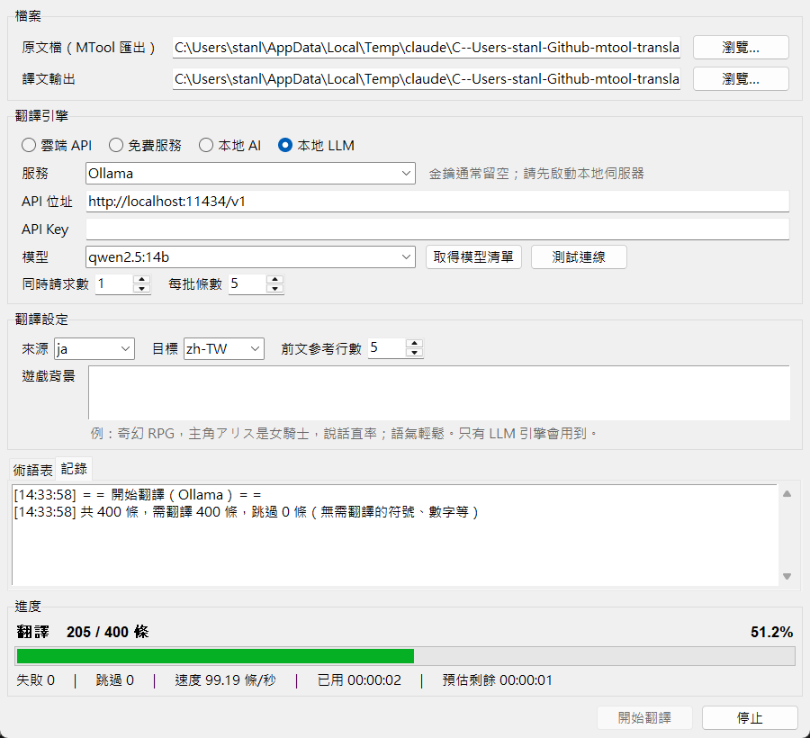

# [MT-4] 顯示正確完整的進度條

> 狀態：完成

## 內文

### 需求
整份遊戲翻譯可能要跑很久，使用者需要隨時知道進度到哪、還要多久。進度條必須正確（數字與實際處理的條數一致，不會倒退、不會超過 100%），而且資訊完整。

### 來源
使用者，2026-10-19 對話：「一定要有正確且顯示完整的進度條。」

### 驗收條件
- [x] 進度條依實際處理完的條數前進，從 0 到總數，不會倒退
- [x] 顯示目前階段（翻譯／擷取術語）、已處理數／總數、百分比
- [x] 顯示失敗數、跳過數、速度、已用時間、預估剩餘時間
- [x] 續翻時進度從已完成的條數起算，速度與預估時間只用本次新翻的條目計算
- [x] 完成時顯示 100%，總數為 0 時直接顯示完成
- [x] 停止時畫面顯示「停止中」，結束後顯示「已停止」與停止當下的條數
- [x] 視窗標題同步顯示百分比，縮到工作列也看得到進度
- [x] 大量進度更新時介面不卡頓

### 測試流程
1. 選一份數百條的原文檔，按「開始翻譯」
2. 預期：進度條穩定前進，各項數字持續更新，視窗標題顯示百分比
3. 翻到一半按「停止」，預期顯示「已停止」與當下條數
4. 再按「開始翻譯」，預期進度從停止的條數接續，最後到 100%

---

# 跟其他票的關係

- Blocks：無
- Blocked by：無
- Related：MT-1、MT-2

---

# Commit-1

## 內文

原本沒有任何進度顯示。
現在視窗底部有進度區：第一行是階段、已處理數／總數與百分比，接著是進度條，最後一行是失敗、跳過、速度、已用時間、預估剩餘時間；視窗標題也會顯示百分比。進度只在每批真正處理完才前進，續翻時從已完成的數量起算。
用 400 條的檔案實測，進度條平穩前進，停在 52.5% 時各欄位數字一致；停止後顯示「已停止」與當下條數；以 MyMemory 翻完 8 條樣本時顯示 7 / 7、100%、跳過 1。自我檢查也確認進度數字只增不減，最後一定等於總數。

### 測試結果

| 項目 | 結果 |
|---|---|
| 核心自我檢查（含進度單調遞增、終值等於總數） | 通過 9 / 9 |
| 400 條實測中途截圖 | 210 / 400、52.5%，各欄位正常 |
| 停止後狀態 | 顯示「已停止」與當下條數 |
| 完成狀態 | 7 / 7、100%、跳過 1 |
| 執行 log | 無 ERROR |

### 截圖

