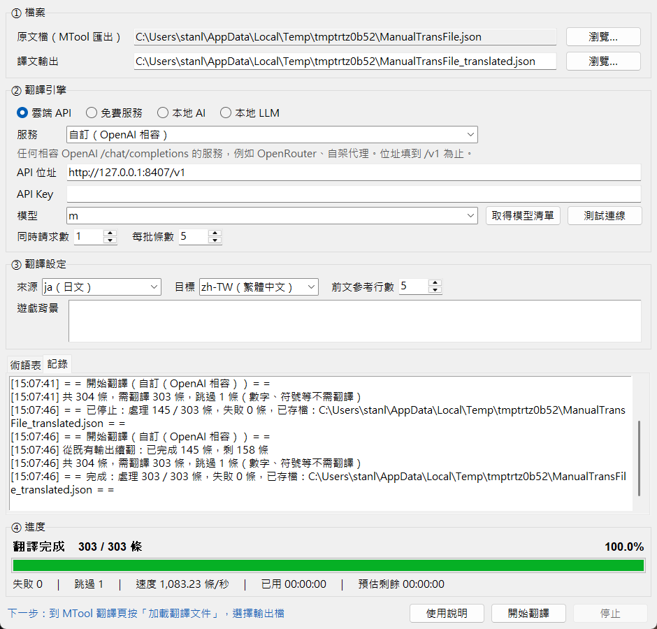

# [MT-6] 修正架構與實作的潛在問題

> 狀態：完成

## 內文

### 需求
全面檢查目前的架構、設計與實作，把潛在問題一次處理掉，且不破壞任何原有功能。翻譯器要好維護、好擴充、穩定、有效率、能容錯、錯誤有確實捕捉與說明、不占用太多記憶體，並確認所有功能都正確無誤。

檢查時找到的問題（自行檢查加上獨立審查）：

- 任何一批被服務拒絕（例如內容太長、被安全過濾擋下）就會中止整份翻譯
- 輸出檔被其他程式暫時鎖住時，存檔失敗會讓整個工作崩潰，結束時的存檔也可能失敗而遺失結果
- 服務掛掉或被限流時沒有自動中止，會對每一批重試到底，可能耗上數小時；也不理會服務要求的等待時間
- 重試等待與停止鍵無關，按停止後可能要等十幾秒到數分鐘
- 自動擷取術語途中出錯，已經找到的術語全部遺失
- 控制碼保護有漏洞：角括號裡的日文（例如 `<勇者の剣>`）被當成標籤藏起來不翻、整行被跳過；Ren'Py、Tyrano、`{name}`、`%02d` 等格式沒有保護；Wolf RPG 注音整段被藏起來
- 思考型模型的回應裡只要出現大括號就解析失敗，每批都要逐句重送
- Sakura 模型被套用一般的 JSON 提示格式，幾乎每批都會失敗；Ollama 預設上下文長度會默默截掉提示詞
- MyMemory 譯文帶有 `&#39;` 這類 HTML 跳脫字元；超長單行無法翻譯
- 大檔案存檔太慢，會拖慢翻譯與畫面
- 續翻時，輸出檔裡原文檔沒有的條目會被刪掉；既有輸出檔損壞時會被直接覆蓋
- 停止時尚未處理的條目被算成失敗
- 翻譯中關閉視窗，進行中的結果會遺失
- 翻譯中仍可更換原文檔與引擎設定，結果可能寫進別的遊戲的術語表
- 設定檔損壞或記得一個已不存在的服務時，程式打不開
- 介面更新出錯時畫面會停止更新；大量失敗訊息會讓記錄區越來越慢
- 背景執行緒直接持有介面物件，有在錯誤執行緒回收介面資源的風險

### 來源
使用者，2026-10-19 對話：「請幫我完整花時間去實際檢查當前架構、設計或是實作有沒有甚麼潛在的問題，一起處理掉 實作時請確保程式碼跟架構好維護，需要保持高擴充性、高穩定性、高效能、高容錯性、好的錯誤捕捉、不會占用太多記憶體、做好抽象化……不要破壞任何原有功能」「然後請確認所有功能都是正確無誤的」

### 驗收條件
- [x] 單一批次被服務拒絕時，只把有問題的那一句保留原文，其餘照常翻完，工作不中止
- [x] 網路斷線、伺服器忙、限流時會等待後重試，並遵守服務要求的等待時間；等待中按停止，2 秒內結束
- [x] 金鑰錯誤、模型不存在、額度用完時立即中止並說明原因；連續多批全部失敗、或連續多次請求被拒絕時自動中止，不會一直空轉
- [x] 輸出檔被其他程式鎖住時翻譯不中斷；結束時仍無法寫入就另存備份檔並告知位置，結果不遺失
- [x] 既有輸出檔損壞時拒絕覆蓋並請使用者處理
- [x] 續翻時保留輸出檔裡原文檔沒有的條目
- [x] 停止時尚未處理的條目不算失敗，下次續翻補上
- [x] 翻譯中關閉視窗，會先停止並存檔再關閉
- [x] 自動擷取術語中途中止時，已找到的術語保留在術語表
- [x] 控制碼保護涵蓋 RPG Maker、YEP、Unity 富文字、Ren'Py、Tyrano／KiriKiri、各種格式字串；角括號裡的日文照常翻譯；Wolf RPG 注音只保留本文；「50% discount」這類一般文字不受影響
- [x] 思考型模型的回應一次就能解析，不需要逐句重送
- [x] Sakura 使用專用的提示格式，一行一句對應；Ollama 送出的上下文長度足以容納提示詞
- [x] MyMemory 譯文的 HTML 跳脫字元會還原；超過單次上限的長句自動切段翻譯
- [x] 10 萬條的原文檔可以完整跑完：翻譯流程本身每秒處理 2 萬條以上、記憶體峰值 100 MB 以內、進度最後等於總數
- [x] 翻譯中原文檔、輸出位置、引擎與翻譯設定全部鎖住，結束後恢復
- [x] 設定檔損壞、內容不合法、記得已不存在的服務時，程式照常開啟並回到預設值；舊版設定自動轉換、金鑰不遺失
- [x] 未預期的程式錯誤寫入記錄檔並提示使用者，介面不會卡死；記錄區只保留最近 2,000 行
- [x] 新增翻譯引擎時，介面自動出現新選項，不需修改介面；新增檔案格式不需修改翻譯流程（為 MT-5 鋪路）
- [x] 原有功能全部保留：四類引擎、測試連線、取得模型清單、術語表新增／編輯／刪除／匯入／匯出／自動擷取、前文參考、遊戲背景、進度條、停止與續翻
- [x] 自動化檢查涵蓋控制碼處理、翻譯流程的各種錯誤情境、每一個引擎實際走 HTTP 的行為（以本機模擬伺服器）、設定轉換，以及開真的視窗操作完整流程，全部通過

### 測試流程
1. 在專案資料夾執行自動化檢查，預期全部通過
2. 開啟翻譯器，選原文檔與任一引擎，按「開始翻譯」，翻到一半按「停止」
3. 預期：2 秒內停止，記錄顯示已處理條數與存檔位置，失敗數為 0
4. 再按「開始翻譯」，預期從停止的條數接續，最後到 100%
5. 用文字編輯器開著輸出檔（或設成唯讀）再翻譯一次，預期翻譯不中斷，結束時提示另存的備份檔位置
6. 把金鑰改錯再開始翻譯，預期立即中止並顯示「金鑰無效」
7. 翻譯中按視窗右上角關閉，選「是」，預期存檔後才關閉，再開啟續翻不會重翻已完成的部分

---

# 跟其他票的關係

- Blocks：無
- Blocked by：無
- Related：MT-1、MT-2、MT-3、MT-4、MT-5、MT-7、MT-8

---

# Commit-1

## 內文

原本只要一批被拒絕、輸出檔被鎖住、或服務暫時掛掉，整份翻譯就可能中止甚至遺失結果；按停止要等很久；部分控制碼沒保護、角括號裡的日文反而不翻；Sakura 與思考型模型幾乎每批都失敗；設定檔一壞程式就打不開。
現在錯誤分成四類各自處理：暫時性的等待重試（遵守服務要求的等待時間，等待中按停止立刻結束）；單批的問題把批次拆開，只隔離有問題的那一句；設定錯誤立即中止並說明；連續失敗自動中止避免空轉。存檔寫不進去時翻譯照常進行，結束時另存備份檔。批次改成邊做邊送，記憶體固定，後面的批次也看得到前面剛翻好的譯文。控制碼保護補上 Ren'Py、Tyrano、格式字串與注音；思考型模型、Sakura、Ollama、MyMemory 各自的特殊情況都已處理。翻譯中鎖住設定、關閉視窗時先存檔、設定檔損壞時回到預設值，錯誤記錄寫到記錄檔。翻譯核心、引擎、檔案格式、介面分開，新增引擎或格式不需改動其他部分。
自動化檢查從 9 項擴充到 64 項，涵蓋每個引擎以本機模擬伺服器實際走 HTTP、各種錯誤情境、設定轉換，以及開真的視窗從測試連線一路操作到翻譯、停止、續翻、中止、關閉，全部通過。10 萬條的原文檔用模擬引擎完整跑完只要 4.9 秒、記憶體峰值 57 MB。用 MyMemory 實際翻譯，控制碼全部還原，`<勇者の剣>` 正確翻成「勇氣之劍」。獨立審查列出的 21 項問題全部處理；只有「譯文剛好與原文相同的條目（例如 魔王→魔王）續翻時會再送一次」刻意不處理，影響只是少量重複請求。

### 測試結果

| 項目 | 結果 |
|---|---|
| 自動化檢查 | 通過 64 / 64 |
| 靜態檢查 | 0 錯誤 |
| 10 萬條大檔（模擬引擎） | 4.9 秒完成，每秒 20,301 條，記憶體峰值 57 MB，0 失敗 |
| MyMemory 實際翻譯 | 3 條翻譯、1 條跳過、0 失敗，控制碼全部還原 |
| 停止後續翻（介面實測） | 停在 145 / 303、失敗 0，續翻完成 303 / 303 |
| 執行 log | 無 ERROR |

### 截圖

