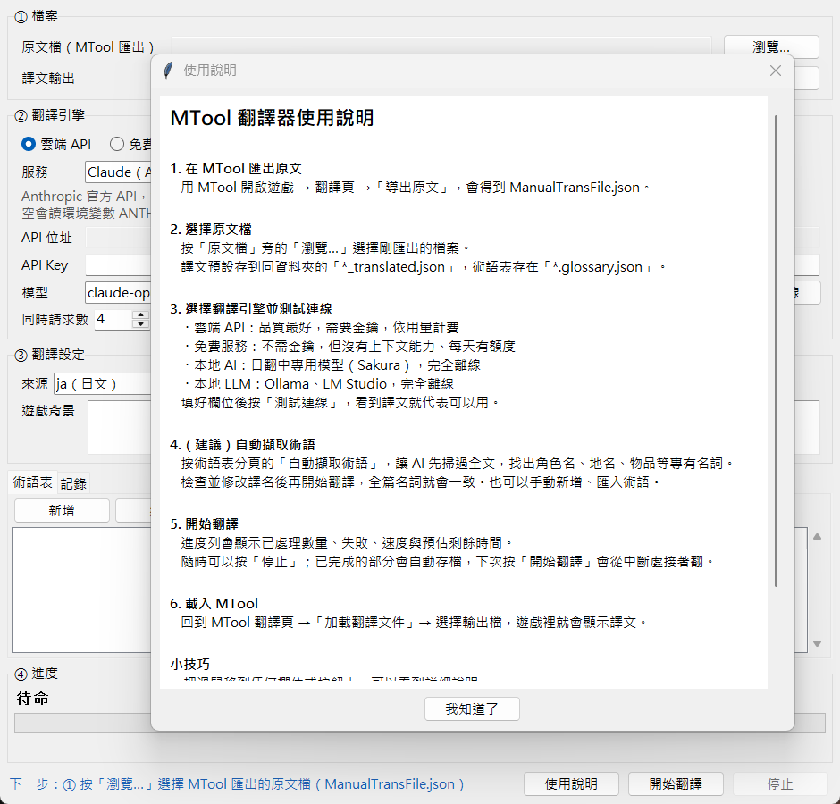
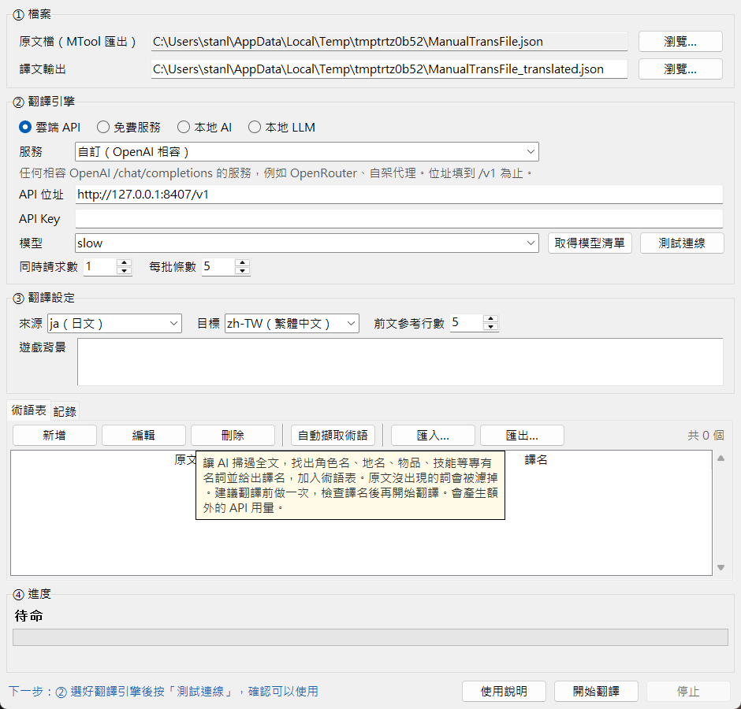
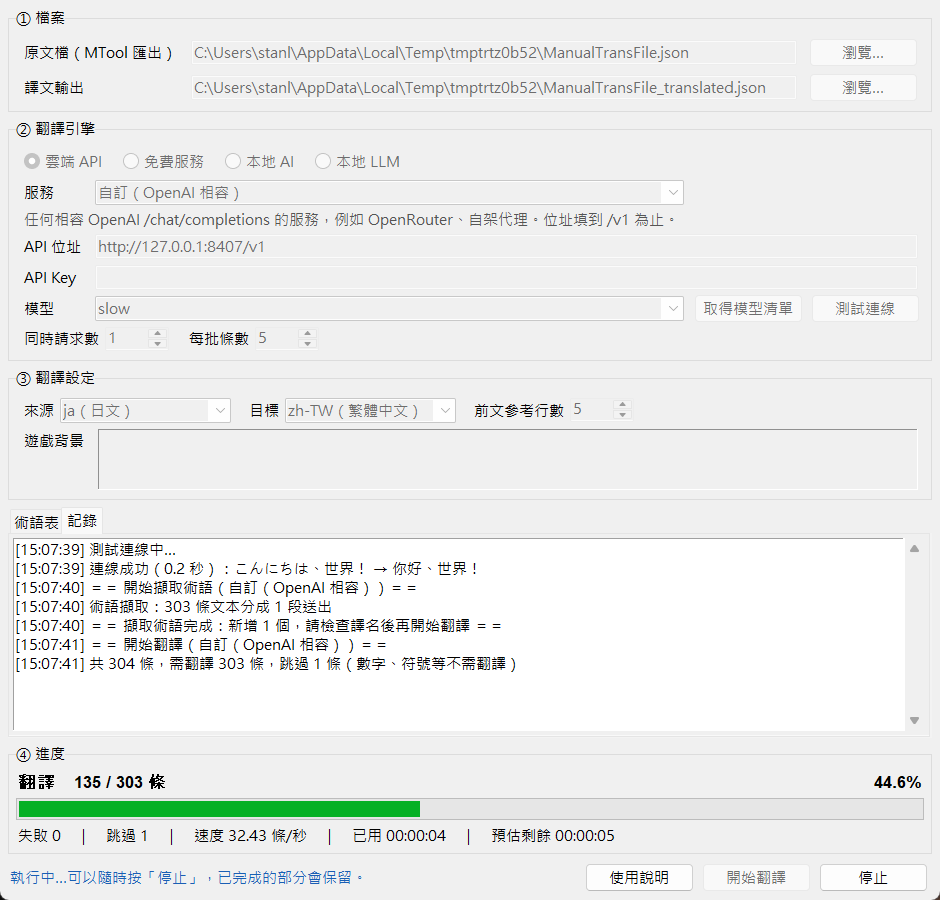

# [MT-7] 加入 Hover 說明與操作引導

> 狀態：完成

## 內文

### 需求
第一次用的人不知道每個欄位是什麼、該按哪個按鈕、下一步要做什麼。介面要有合適的功能引導，以及滑鼠停留時顯示的說明（Hover）。

- 每個欄位、按鈕、選項都有說明，說明內容要隨目前選的服務變化
- 第一次開啟時主動說明完整流程，之後也能隨時再看
- 依目前狀態提示下一步
- 執行中不能改的設定要明確看得出來；目前引擎不支援的功能要停用並說明原因

### 來源
使用者，2026-10-19 對話：「做好抽象化且要有合適的功能引導和說明 Hover」。

### 驗收條件
- [x] 滑鼠停在每個欄位、按鈕、選項上約半秒會顯示說明，移開或點擊就消失
- [x] 金鑰欄位、服務選單、自動擷取術語的說明會依目前選的服務改變
- [x] 中英文混排的說明正常換行，不會整段跳到下一行
- [x] 第一次開啟自動顯示使用說明，按「我知道了」後不再自動顯示；右下角「使用說明」可隨時再開
- [x] 視窗左下角依狀態提示下一步：選原文檔 → 測試連線 →（建議）自動擷取術語 → 開始翻譯 → 到 MTool 加載翻譯文件；執行中提示可以隨時停止
- [x] 翻譯中所有設定欄位變灰鎖住，結束後恢復
- [x] 目前引擎不支援的功能停用（例如免費服務的自動擷取術語、模型清單），停在上面會說明原因
- [x] 區塊依步驟編號（① 檔案 ② 翻譯引擎 ③ 翻譯設定 ④ 進度）
- [x] 術語表的按鈕在較矮的視窗也完整顯示

### 測試流程
1. 刪掉設定檔後開啟翻譯器，預期自動顯示使用說明
2. 按「我知道了」後關閉再開啟，預期不再自動顯示；按右下角「使用說明」可以再開
3. 滑鼠依序停在各欄位與按鈕上，預期都有說明；切換服務後，金鑰欄位的說明跟著變
4. 照左下角的提示一步步操作，預期每完成一步提示就更新
5. 開始翻譯，預期設定欄位全部變灰；結束後恢復
6. 切到「免費服務」，預期「自動擷取術語」與「取得模型清單」停用，停在上面看得到原因

---

# 跟其他票的關係

- Blocks：無
- Blocked by：無
- Related：MT-2、MT-3、MT-4、MT-6、MT-9

---

# Commit-1

## 內文

原本介面沒有任何說明，第一次用的人要自己猜每個欄位的意思和操作順序。
現在每個欄位、按鈕、選項都有滑鼠停留說明，金鑰、服務、自動擷取術語的說明會依目前的服務改變；第一次開啟會顯示完整的使用說明，之後可從右下角再開；左下角會依狀態提示下一步。翻譯中設定欄位全部變灰鎖住，目前引擎不支援的功能會停用並說明原因。區塊依操作步驟編號，術語表按鈕改成一列放在上方。
用自動化檢查與實際開視窗截圖確認：第一次開啟會出現使用說明，關掉後不再自動出現；說明框內容會跟著服務變化，中英混排正常換行；下一步提示依序從選檔、測試連線、擷取術語、開始翻譯一路變到「到 MTool 加載翻譯文件」；翻譯中欄位全部鎖住。

### 測試結果

| 項目 | 結果 |
|---|---|
| 自動化檢查（含介面操作） | 通過 64 / 64 |
| 使用說明、Hover、下一步提示、執行中鎖定 | 實際開視窗截圖確認 |
| 執行 log | 無 ERROR |

### 截圖

