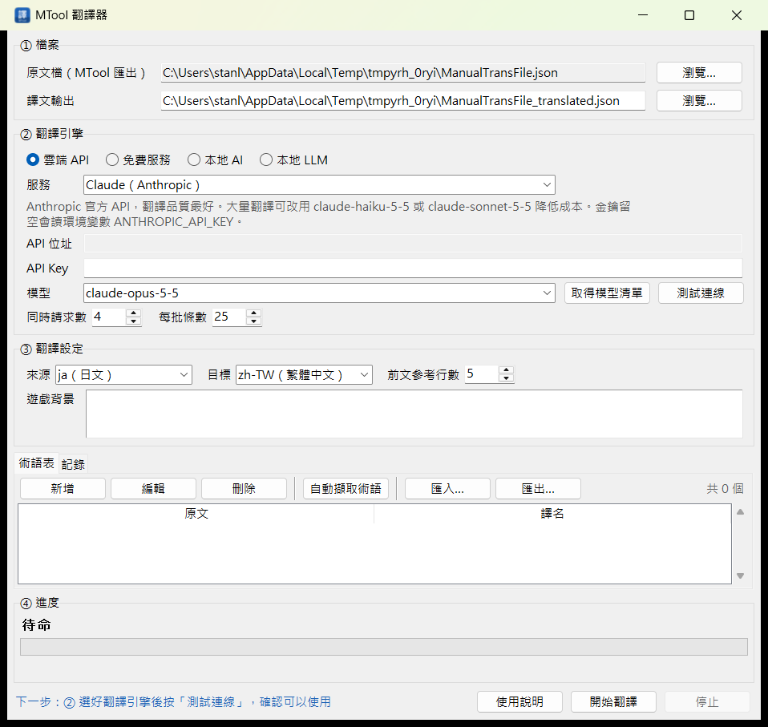

# [MT-8] 打包成一鍵開啟的程式

> 狀態：完成

## 內文

### 需求
目前要先裝 Python、再用命令列執行才能開啟翻譯器。希望打包成雙擊就能開的程式：

- 開啟速度要夠快
- 不需要一直維護打包相關的檔案，重新打包只要一個步驟
- 設定與記錄在打包後要能保存，不會每次開都不見
- 打包出來的程式要確認真的能用，不能交出一個打不開的檔案

### 來源
使用者，2026-10-19 對話：「可以打包讓我可以一鍵打開 APP 嗎?」「然後打包有更好的做法嗎?最好是該 exe 打開速度要夠快，但又不用一直維護檔案」

### 驗收條件
- [x] 一個指令完成打包：安裝打包工具、跑全部自動化檢查、打包、驗證打包結果，任何一步失敗就停止
- [x] 打包設定全部集中在一支打包腳本，不需要另外維護設定檔
- [x] 打包後的程式不需要安裝 Python，雙擊即可開啟，標題列與工作列有自己的圖示
- [x] 實測比較資料夾版與單一 exe 的啟動時間，預設採用較快的版本：資料夾版在 1 秒內開好
- [x] 設定與記錄存在程式旁邊，關閉再開啟仍保留；程式放在不能寫入的資料夾時改存到使用者資料夾
- [x] 打包後自動執行自我檢查，包含照實際雙擊的方式把主視窗建起來，結果列出每個元件是否正常
- [x] 資料夾版另外產生 zip，方便傳給別人
- [x] 使用者也可以自己執行自我檢查，產生問題回報用的報告

### 測試流程
1. 在專案資料夾執行打包指令
2. 預期：自動化檢查與打包後的自我檢查都通過，最後顯示 exe 位置與大小
3. 雙擊 exe，預期 1 秒內出現視窗，標題列有翻譯器圖示
4. 切換引擎、填金鑰後關閉，再開啟，預期設定都還在
5. 對 exe 執行自我檢查，預期 self-check.txt 全部通過

---

# 跟其他票的關係

- Blocks：無
- Blocked by：無
- Related：MT-6、MT-9、MT-10

---

# Commit-1

## 內文

原本只能從原始碼執行，要先裝 Python 和套件。
現在一個指令就能打包：自動跑完全部檢查後打包，再用打包好的程式跑自我檢查，確認元件齊全、每個翻譯引擎都建得起來、主視窗真的開得起來，才算完成。實測資料夾版平均 0.58 秒開好、單一 exe 平均 1.7 秒（每次都要先解壓），所以預設打包成資料夾版並附 zip，需要單一檔案時也可以加參數打包。設定與記錄存在 exe 旁邊，整個資料夾帶著走即可，覆蓋更新時設定也會保留。新增了程式圖示。
打包過程中發現，雙擊啟動時讀設定的位置寫錯，程式一開就當掉。原本的測試都有指定設定檔位置，所以沒抓到。已修正，並補上「完全照雙擊方式啟動」的測試，也把真的建出主視窗加進打包後的自我檢查，同類問題之後在打包時就會被擋下。修正後用打包好的 exe 實際開啟、截圖確認正常。

### 測試結果

| 項目 | 結果 |
|---|---|
| 自動化檢查 | 通過 74 / 74 |
| 打包後自我檢查（資料夾版、單一 exe） | 各 17 項全部通過，含主視窗啟動 |
| 啟動時間（各實測 3 次） | 資料夾版平均 583 ms；單一 exe 平均 1,705 ms |
| 檔案大小 | 資料夾版 39.5 MB（zip 20.3 MB）；單一 exe 20.5 MB |
| 打包後實際開啟 | 正常，圖示、設定位置、記錄檔都正確 |

### 截圖

